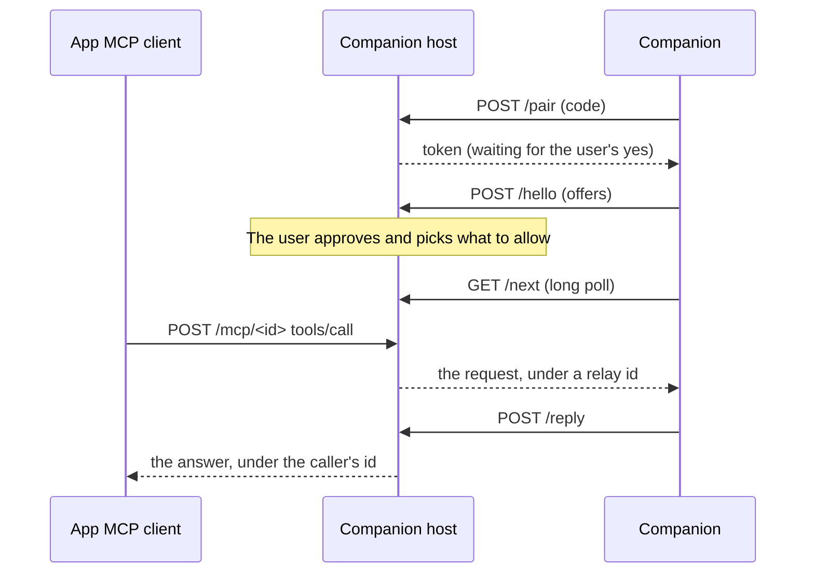

# Companion devices

A companion is a phone, another computer or a headless box that pairs with
the app and lends it what it has: a camera, a screen, its location, text
messages (Android), a voice, a wake phrase or button, a panel to show
things on, and the MCP servers and skills it hosts.

This page is the protocol. The code is in:

| Part | File |
| --- | --- |
| Paired list and consent rules | `crates/grokhub-core/src/companion_nodes.rs` |
| Host: pairing, relay, MCP endpoint | `crates/grokhub-hub/src/node_host.rs` |
| Companion program (`grokhub-hub node`) | `crates/grokhub-hub/src/node_client.rs` |

## How it fits together

A companion can't be dialed: a phone sits behind NAT, a laptop sleeps. So
the companion dials the app and holds a long poll. The app's requests go
out on that poll, and the companion answers each one.

The requests are MCP. The app's own MCP client reaches each companion at a
loopback address, as if the companion were one more MCP server. Each
capability is a tool, so a companion's camera or text messages pass through
the same tool approvals, output fencing and Offline switch as any other
MCP tool.



## Consent

A capability is usable only after two yeses:

1. The companion offers it. Nothing is offered by default; the person at
   the companion turns each one on.
2. The user allows it for that companion in the app, under
   Devices → Companions. Pairing alone allows nothing.

The host enforces the second yes. It takes tools the user didn't allow out
of every `tools/list` answer, and it refuses a `tools/call` for one before
the request leaves this computer. Removing a companion stops its token at
once and ends every call waiting on it.

| Offer | Tools | Notes |
| --- | --- | --- |
| `camera` | `camera_snap` | A photo as an MCP image. |
| `screen` | `screen_snap` | A screenshot as an MCP image. |
| `location` | `location_get` | Latitude, longitude, accuracy. |
| `sms` | `sms_list`, `sms_send` | Android only. |
| `talk` | `talk_say`, `talk_listen` | Also allows `heard` events. |
| `wake` | none | Allows `wake` events. |
| `canvas` | `canvas_show`, `canvas_clear` | A panel spec, see below. |
| `mcp` | every other tool | The companion's own MCP servers. |
| `skills` | `skills_list`, `skill_read` | The companion's skill files. |

A companion marks read-only tools (`camera_snap`, `screen_snap`,
`location_get`, `sms_list`, `skills_list`, `skill_read`) with
`readOnlyHint: true`. Tools that change something or reach someone
(`sms_send`, `talk_say`, `canvas_show`) don't, so they ask first wherever
the app asks before a change.

A companion names its MCP servers' tools `<server>-<tool>`, so they never
take the name of one of the tools above.

## Transport

Version 1 is plain HTTP on the companion port, **18767**, like the hub on
18766. The host takes companion requests only from a private address: the
home network, link-local, a VPN in 100.64.0.0/10 (Tailscale), or this
computer. It refuses any request that carries an `Origin` header, so a web
page can't pair or poll. TLS with a certificate pinned at pairing is a
follow-up.

Every path starts with `/node/v1`. Bodies are JSON. A companion sends its
token as `Authorization: Bearer <token>`.

### `GET /health`

No token. Answers `{"ok": true, "kind": "companion-host", "version": 1}`.

### `POST /pair`

```json
{ "code": "ABC-123", "id": "pixel-8", "name": "Pixel 8", "platform": "android" }
```

The app shows the one-time code under Devices → Companions. It lasts 15
minutes and burns after 10 wrong guesses. `id` is the companion's own, 1 to
40 of `a-z`, `0-9` and `-`. Pairing the same id again replaces its token
and its approval.

Answer: `{"ok": true, "token": "…", "version": 1, "host": {"name": "…"}}`.
The token is shown once; the host keeps only its SHA-256 in
`companions.json`, readable by this user only.

Errors: 400 with no open code or a bad id, 403 for a wrong code or a full
list (16 companions).

### `POST /hello`

```json
{ "offers": ["camera", "location", "talk", "mcp"] }
```

Sent at start and whenever the offers change. Unknown offers are dropped.
Answer: `{"ok": true, "approved": false, "offers": [...], "allowed": [...]}`.

### `GET /next`

The long poll. Until the user approves the companion it answers at once
with `{"ok": true, "pending": true}`; the companion waits a few seconds and
polls again. Once approved it waits up to 25 seconds and answers
`{"ok": true, "rpc": {…}}` with one JSON-RPC message, or `{"ok": true}`
with none. A companion holds at most two polls (429 past that). It counts
as online while it polls and for 40 seconds after.

Requests carry a relay id (`"r17"`), not the caller's. Notifications carry
no id and need no reply.

### `POST /reply`

```json
{ "rpc": { "jsonrpc": "2.0", "id": "r17", "result": { "content": [] } } }
```

Answer: `{"ok": true, "taken": true}`. `taken` is false for an answer
nobody waits for: late, or never asked.

### `POST /event`

```json
{ "kind": "wake", "text": "" }
{ "kind": "heard", "text": "what's on my calendar today" }
```

`wake` needs the `wake` offer allowed, `heard` needs `talk`. The app takes
events and opens a chat with what was heard. Text is cut to 2,000
characters; the host keeps the newest 32 events.

### `POST /mcp/<id>`

The app's side, for its MCP client only: a loopback caller with the local
key (`Authorization: Bearer <key>`) and no `Origin`. One JSON-RPC message
per POST, answered as JSON (MCP streamable HTTP without a server stream, so
`GET` is 405).

Only `initialize`, `ping`, `tools/list`, `tools/call` and notifications go
out. Anything else is answered `-32601` here. The host answers `-32001`
itself when the companion isn't paired, isn't approved or is offline, and
when the companion doesn't answer within 120 seconds.

## Tool shapes

`camera_snap` and `screen_snap` take `{}` (a camera may take
`{"facing": "back" | "front"}`) and answer MCP image content:

```json
{ "content": [ { "type": "image", "data": "<base64 JPEG>", "mimeType": "image/jpeg" } ] }
```

`location_get` answers text JSON: `{"lat": …, "lon": …, "accuracyM": …}`.

`sms_list` takes `{"limit": 10}` and answers the newest messages.
`sms_send` takes `{"to": "+15555550100", "body": "…"}`.

`talk_say` takes `{"text": "…"}` and speaks it on the companion.
`talk_listen` takes `{}`, listens once, and answers what it heard as text.
A companion lists it only when it can transcribe.

`canvas_show` takes a panel spec, the same declarative JSON the app's
`show_panel` tool uses (`crates/grokhub-core/src/panel_spec.rs`): headings,
text, lists, tables, key-value rows, buttons, inputs and progress. It never
carries HTML or script, so a panel can't run code on the companion.
`canvas_clear` takes `{}`.

`skills_list` answers names and descriptions; `skill_read` takes
`{"name": "…"}` and answers the skill's `SKILL.md`.

## Running a companion

`grokhub-hub node` turns the device it runs on into a companion:

```sh
grokhub-hub node pair 192.168.1.20 ABC-123 --name "Pixel 8"
grokhub-hub node offer camera,location,talk,wake
grokhub-hub node run
```

`pair` takes the number address and the code the app shows, and saves the
pairing in `companion-node.json` in the config folder, readable by this
user only. `offer` sets what this device lends; it starts with nothing.
`run` stays connected and prints a line for each tool the app calls.
`wake` sends a wake event, and `wake --listen` sends what you say as a
`heard` event. `status` shows the pairing and what this device can lend.
`forget` deletes the pairing here.

What each device can lend:

| Offer | Android (Termux with Termux:API) | Linux | macOS | Windows |
| --- | --- | --- | --- | --- |
| `camera` | `termux-camera-photo` | `ffmpeg` and a webcam | `imagesnap` | no |
| `screen` | no | yes | yes | yes |
| `location` | `termux-location` | no | no | no |
| `sms` | `termux-sms-list`, `termux-sms-send` | no | no | no |
| `talk` | `termux-tts-speak`; listens with `termux-speech-to-text` | `espeak-ng`, `espeak` or `spd-say` | `say` | the built-in voice |
| `canvas` | `termux-open` | `xdg-open` | `open` | yes |
| `wake`, `mcp`, `skills` | yes | yes | yes | yes |

Programs run with an argument list, never through a shell. Text that
starts with `-` gets a leading space so a program can't read it as an
option. On Windows the words to speak travel in an environment variable,
never inside the script. Photos and screenshots past 1,600 pixels on the
long side are scaled down to JPEG.

A panel opens once as a local page with no script and a strict content
policy; the page reloads every two seconds, so the next `canvas_show`
appears in the same window.

The `mcp` offer lends the MCP servers this device has connected, named
`<server>-<tool>`. Answers go back without this device's untrusted fence,
because the app fences them as its own MCP output. A server that is another
companion's relay is never lent on: that companion's person allowed this
device, not whoever it lends to. The `skills` offer reads the skills in
this device's `.claude/skills` and `.grok/skills` folders and the app's own
skill folder; the built-in skills stay out.

## What isn't in version 1

- TLS on the companion port.
- Pushing a companion's skills into the app's own skill list; the model
  reads them through `skill_read`.
- A server stream for MCP notifications from the companion to the app.
